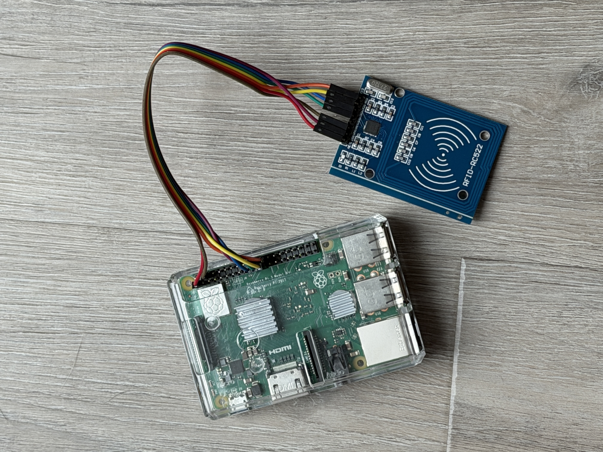
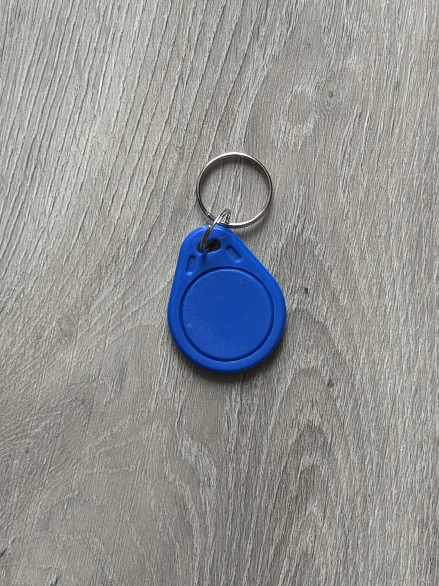
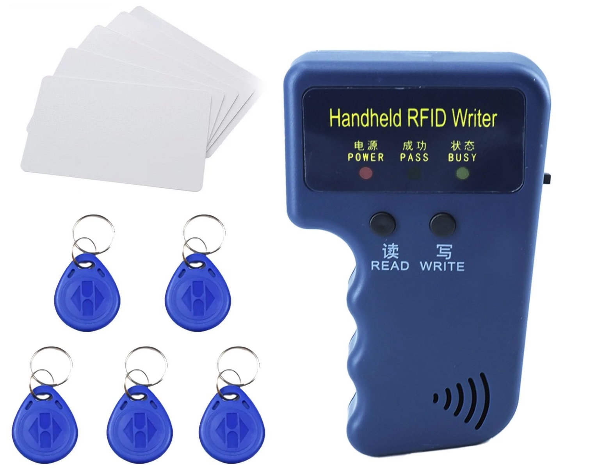

# rfid-pi

Read and write RFID chips with an RC522 reader on a Raspberry Pi. An Ansible
playbook sets the Pi up; the `rfid` command does the reading and writing. It
needs nothing beyond Raspberry Pi OS and its `python3-spidev` package. Older
tutorials use SPI-Py and MFRC522-python, which are Python 2 and do not run on
current Raspberry Pi OS.



## Wiring

| RC522 | Raspberry Pi header pin |
|---|---|
| SDA | 24 (GPIO 8, CE0) |
| SCK | 23 (GPIO 11) |
| MOSI | 19 (GPIO 10) |
| MISO | 21 (GPIO 9) |
| IRQ | not connected |
| GND | 6 |
| RST | 22 (GPIO 25) |
| 3.3V | 1 (never 5 V) |

## Setting up the Pi

Flash Raspberry Pi OS Lite (Bookworm or Trixie) with Raspberry Pi Imager,
with SSH for root and your key. Put the Pi's address in `inventory.ini`, then:

```sh
ansible-playbook playbook.yml
```

It enables SPI, drives the reader's reset pin high from boot, installs
`python3-spidev` and `/usr/local/bin/rfid`, reboots if the boot config
changed, and fails unless the reader answers over SPI, which tests the wiring
without a chip. It then starts the web page and fails unless that answers too.
Running it again changes nothing.

## The web page

Open **http://<pi-address>/** (the Pi's address, port 80) in a browser on the
home network. **Read** shows what is on the chip on the reader; **Write** writes a
text, a link or raw bytes to it, then reads it back to compare. After a write
the next chip can go straight on: press Write again. The page waits up to
20 seconds for a chip, and is in English or German (the browser's language,
or the switch at the top).

It runs as the systemd service `rfid-web` (`rfid serve --port 80`), which the
playbook installs and checks. There is no login: anyone on the home network
can read and write chips with it, which is fine for a Pi that is switched on
only while chips are written. It accepts JSON only, so another website cannot
write chips through your browser. Not for the internet.

The API behind it: `GET /api/info`, `POST /api/read` (`{"dump": true}`
optional) and `POST /api/write` (`{"kind": "text"|"url"|"hex", "value": "…"}`),
both with optional `"key"` (12 hex digits) and `"block"`. Answers are JSON;
408 means no chip in time, 409 the reader is busy, 422 the chip refused.

## Reading and writing from the shell

On the Pi:

```sh
rfid info                              # does the reader answer?
rfid read                              # hold a chip to the reader
rfid read --dump                       # every block or page, in hex
rfid write "Hallo"                     # text
rfid write --url https://example.org   # a link a phone opens (NTAG only)
rfid write --hex 0011223344            # raw bytes
```

Every write is read back and compared. Two kinds of chip work:

- **MIFARE Classic 1K/4K** (the white card and blue fob that come with an
  RC522): data goes into the data blocks from block 8 on (`--block` to
  change it), zero-padded. The factory key `FFFFFFFFFFFF` is used unless
  `--key` says otherwise. Block 0 (the UID) and the sector trailers (the
  keys and access bits) are never written, so a chip cannot be locked by
  accident. Phones read the UID of these chips, not text.
- **NTAG213/215/216 and MIFARE Ultralight** (NFC stickers): text and URLs are
  written as an NDEF message from page 4 on, which is what a phone reads.
  The lock and configuration pages are never written.

`rfid --help` lists every option. Exit codes: 0 done, 1 error, 2 no chip
within `--timeout` seconds (default 30).

## Tests

```sh
bash tests/rfid.test.sh
```

They run without a reader: the checksum against ISO 14443-3's own examples,
the NDEF encoding, the write paths against a simulated chip, and the web
page's API and language choice.

## If your tag won't read: check the frequency

The RC522 is a **13.56 MHz** reader. Many door fobs — the cheap blue teardrop
kind especially — are **125 kHz (EM4100)** instead, and this reader is
completely silent to them: no error, just nothing. The two bands don't
interoperate, so no amount of wiring or code will help.



*Quick test:* hold the tag to an NFC phone. If the phone reacts, it's
13.56 MHz and this reader can use it. If nothing happens, it's probably
125 kHz — and you need a **125 kHz copier** instead, which reads the fob and
writes a T5577 blank, standalone, no computer:


